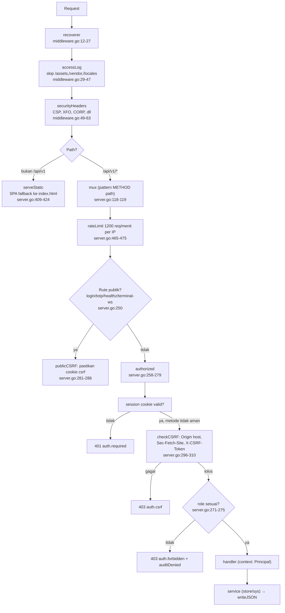
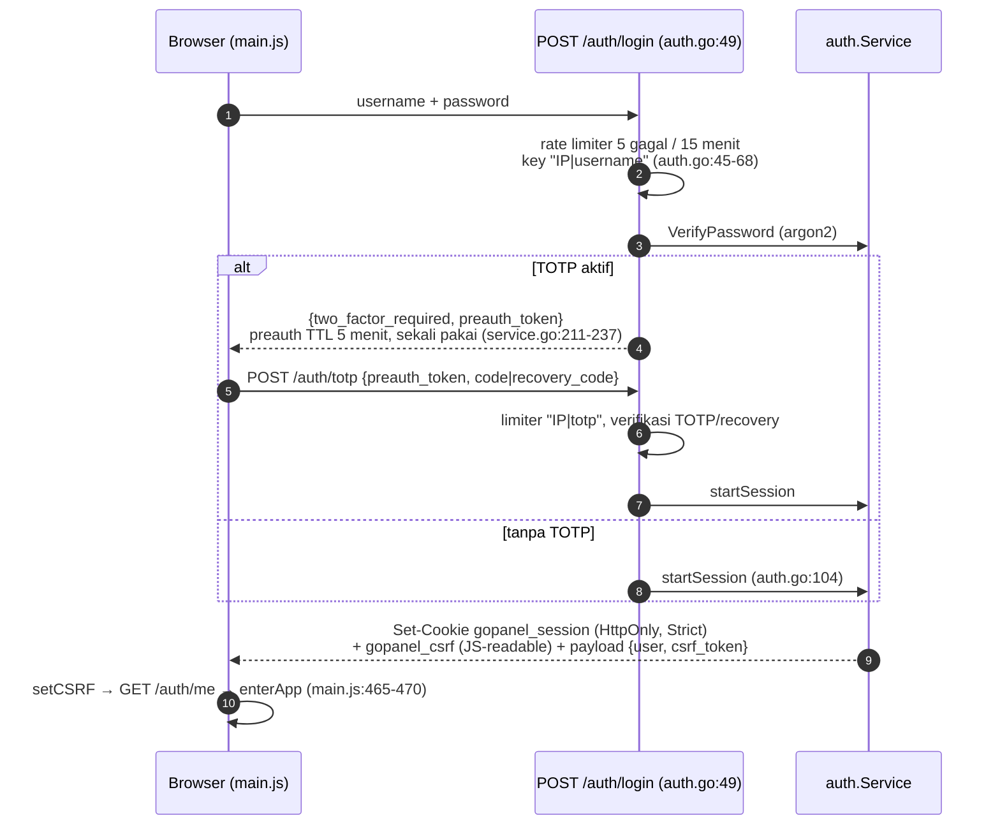
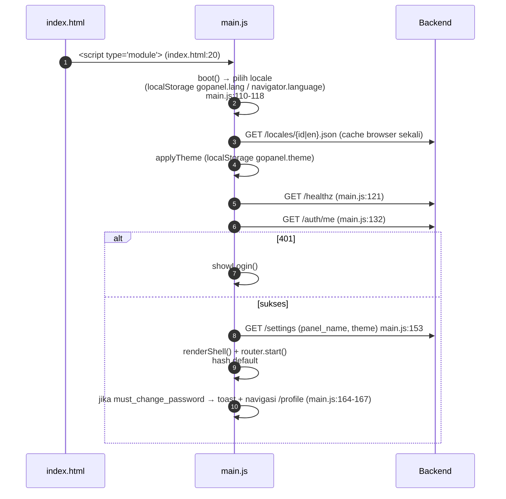
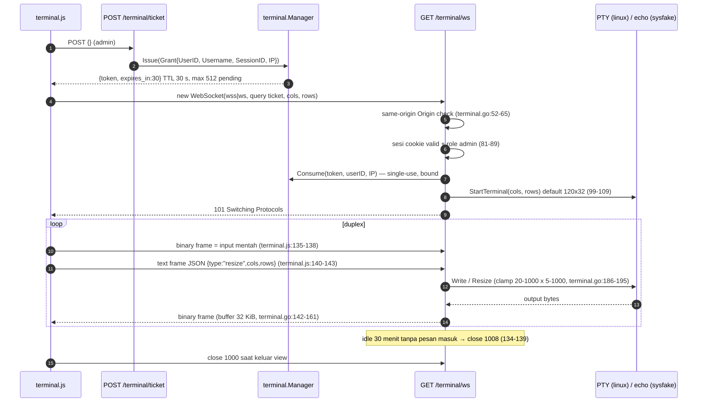

# GoPanel — Peta File & Alur Runtime (`map_flow.md`)

Dokumen referensi untuk memahami struktur kode dan alur runtime GoPanel dengan cepat.
Semua path relatif terhadap root repo. Nomor baris merujuk ke kondisi file saat dokumen ini
ditulis (bisa bergeser setelah kode berubah). Semua fakta di bawah diambil langsung dari
kode; tidak ada endpoint/flag/transport yang dikarang.

Isi:
1. [Peta direktori & file](#1-peta-direktori--file)
2. [Alur startup & shutdown](#2-alur-startup--shutdown)
3. [Alur request HTTP](#3-alur-request-http)
4. [Alur auth](#4-alur-auth)
5. [Alur boot SPA & rebuild](#5-alur-boot-spa--rebuild)
6. [Alur job/background + SSE](#6-alur-jobbackground--sse)
7. [Alur terminal (WebSocket)](#7-alur-terminal-websocket)
8. [Alur fitur lain (ringkas)](#8-alur-fitur-lain-ringkas)
9. [Peta dependensi frontend → endpoint](#9-peta-dependensi-frontend--endpoint)
10. [Titik ekstensi & konvensi](#10-titik-ekstensi--konvensi)
11. [Catatan & pengamatan dari kode](#11-catatan--pengamatan-dari-kode)

---

## 1. Peta direktori & file

### 1.1 Root repo

```text
panel-vps/
├── cmd/gopanel/main.go      # entrypoint: flag, config, DB, services, server, shutdown
├── internal/                 # 24 paket backend (tabel 1.2)
├── web/                      # frontend SPA vanilla JS, di-embed saat compile (tabel 1.3)
│   ├── embed.go              # //go:embed index.html assets locales (web/embed.go:9)
│   ├── index.html            # shell + boot screen, load module main.js (index.html:20)
│   ├── assets/css/app.css    # satu-satunya stylesheet
│   ├── assets/js/*.js        # main, router, api, i18n, ui, icons, jobwatch, terminal-emulator
│   ├── assets/js/views/      # 15 view (dashboard, sites, ... , users)
│   └── locales/{en,id}.json  # kamus i18n
├── config.json               # config lokal (dev); dibuat otomatis dari default jika tidak ada
├── go.mod / go.sum           # module `gopanel`, go 1.26.3
├── gopanel-dev.exe           # hasil build Windows (binary lokal, bukan source)
├── dev.log                   # log runtime lokal
├── csrf.txt, jar.txt, demo.zip, dl.tar.gz   # artefak manual testing; bukan bagian aplikasi
├── deploy/                   # direktori kosong (belum ada skrip deploy)
├── data-dev/                 # data runtime mode -dev (lihat 1.5)
└── README.md                 # dokumen utama; bagian "Peta file dan alur" menunjuk ke file ini
```

Tidak ada `*_test.go`, Makefile, Dockerfile, unit systemd, atau toolchain frontend
(Node/npm) di repo. Frontend tidak punya dev server/hot reload.

### 1.2 Paket `internal/`

| Paket | File kunci | Tanggung jawab |
|---|---|---|
| `acme` | `acme/acme.go` | Klien ACME (lego): akun, webroot challenge, penerbitan sertifikat; `Configured()` dipakai capability `acme` |
| `apps` | `apps/apps.go`, `apps/job.go` | Katalog app statis + deteksi terpasang via `dpkg-query`; job `app-install` dan `apt-update` (apps/job.go:12-13) |
| `archive` | `archive/archive.go` | Ekstraksi tar/zip yang aman (zip-slip guard, limit: 20.000 file, total 2 GiB, 1 file 1 GiB, depth 64 — archive.go:31-38) |
| `audit` | `audit/audit.go` | Pencatatan event audit ke DB; retensi 90 hari via scheduler |
| `auth` | `auth/service.go`, `password.go`, `totp.go`, `ratelimit.go` | Sesi/cookie/CSRF, hash password (argon2), TOTP, rate limiter login, enkripsi AES-GCM (`Encrypt`), bootstrap admin pertama (service.go:241-265) |
| `backup` | `backup/backup.go`, `backup/job.go` | Backup site (tar.gz root) & database (`mysqldump` + gzip), restore, retensi `keep`; job `backup` (concurrency 2) dan `backup-restore` (1) |
| `certs` | `certs/certs.go` | Orkestrasi SSL per-site; job `ssl-issue` (concurrency 2, certs.go:18) |
| `config` | `config/config.go` | Struct config, default dev/prod (config.go:62-118), load file+env (120-164, `applyEnv` 166), `EnsureSecretKey` (225) |
| `cronjobs` | `cronjobs/cronjobs.go`, `cronjobs/job.go` | CRUD cron panel (DB = sumber kebenaran), tulis `cron.d/gopanel` atomik (syncLocked, cronjobs.go:167-197), run-now sebagai job `cron-run` (job.go:10, timeout 30 menit, cronjobs.go:233-264) |
| `databases` | `databases/databases.go` | Create/drop DB & user via MySQL CLI, generate password 24 char (databases.go:106-109), enkripsi password (140), rollback bertingkat (137-150) |
| `db` | `db/db.go`, `db/migrations/0001_init.sql` | SQLite (modernc, tanpa CGO): DSN `foreign_keys + busy_timeout(5000) + WAL`, **1 koneksi saja** (db.go:21-27); migrasi embed diurutkan nama file, dicatat di `schema_migrations` (db.go:40-85); helper `WithTx` |
| `execx` | `execx/execx.go` | Eksekusi perintah dengan **allowlist** (systemctl, nginx, mysql, mysqldump, apt-get, dpkg-query, ufw, openssl, crontab, bash, journalctl — execx.go:19-31), timeout & batas output |
| `files` | `files/files.go`, `files/archive.go` | File manager: root ber-token, sandbox `os.OpenRoot` + `cleanRel` (files.go:106-133), list/read/write/upload, rename/move/copy/chmod/delete, search (skip .git, node_modules, dst — files.go:85-87), archive/extract (archive.go:16,78) |
| `httpapi` | `server.go` (rute), `middleware.go`, `respond.go`, + handler per domain (`auth.go`, `system.go`, `sites.go`, `databases.go`, `files.go`, `backups.go`, `cron.go`, `firewall.go`, `apps.go`, `jobs` di `system.go`, `settings.go`, `users.go`, `terminal.go`) | Router `http.ServeMux` (pattern Go 1.22 `METHOD /path/{param}`), middleware, format respons, SSE jobs, WS terminal |
| `jobs` | `jobs/manager.go`, `jobs/runner.go` | Job engine: worker pool + antrean + semaphore per tipe + ring event + persist DB (detail di §6) |
| `metrics` | `metrics/metrics.go` | Sampling CPU/RAM/disk tiap 30 s via gopsutil, simpan DB, retensi 7 hari (metrics.go:51-56); `Overview`/`History`/`Snapshot` |
| `model` | `model/model.go` | Struct bersama (User, Session, Site, Domain, Database, Backup, Job, CronJob, AuditEvent, Settings, dll) + role constants |
| `scheduler` | `scheduler/scheduler.go` | Cron internal (robfig/cron): poll jadwal backup `@every 30s` (71-72), prune `@every 6h` (75-77, 163-190), renew SSL harian jam 4 menit acak 5-54 (79-82) |
| `sites` | `sites/sites.go` | CRUD site + domain, validasi root/PHP/upstream, render template vhost (sites.go:681), `Apply`: tulis config → symlink enable → `nginx -t` → reload, dengan rollback (sites.go:617-652) |
| `store` | `store/store.go` + 11 file per domain (`users`, `sessions`, `sites`, `databases`, `backups`, `schedules`, `jobs`, `cron`, `audit`, `metrics`, `settings`) | Akses SQLite; query + transaksi untuk semua tabel |
| `sys` | `sys/sys.go` (interface `System`), `factory/` (`factory_linux.go`, `factory_other.go`), `linux/` (`linux.go`, `nginx.go`, `mysql.go`, `aptufw.go`, `terminal.go`), `sysfake/fake.go` | Abstraksi OS. Seleksi **by GOOS**, bukan flag: build linux → `linux.New`; selain itu → `sysfake.New` (factory_other.go:11-13). `sysfake` mensimulasikan nginx/MySQL/UFW/apt/services/metrics dan terminal echo (fake.go:467-474) |
| `terminal` | `terminal/ticket.go` | Ticket WS: TTL 30 s (ticket.go:23), single-use, bound user+IP (ticket.go:100), `MaxPending` 512 (ticket.go:25), token disimpan sebagai SHA-256 digest |

### 1.3 Frontend `web/`

| File | Isi penting |
|---|---|
| `web/index.html` | Boot screen statis → `<script type="module" src="/assets/js/main.js">` (index.html:20) |
| `web/embed.go` | `//go:embed index.html assets locales` → semua aset dibakar ke binary (embed.go:9) |
| `assets/js/main.js` | `boot()` (110-144): locale → healthz → auth/me → `enterApp`; `canWrite`/`isAdmin` (21-27); `NAV` (29-62), `ROUTES` (64-80); `renderShell` (170-207); login/TOTP (350-505); logout (306-315); `switchLanguage` (509-512, tidak dipakai view mana pun) |
| `assets/js/router.js` | Hash router `#/path?query`; `createRouter` (3-83), cleanup per view, dynamic `import()` view |
| `assets/js/api.js` | `fetch` wrapper prefix `/api/v1`, `credentials: 'same-origin'` (68-74), header `X-CSRF-Token` utk POST/PUT/PATCH/DELETE (64-67), 401 → handler login (75-78), `upload` via XHR + progress (89-115), `downloadURL` (117-119) |
| `assets/js/i18n.js` | `loadLocale` fetch `/locales/{id|en}.json`, fallback en (10-34); `t(key, vars)` (48-56) |
| `assets/js/ui.js` | Helper DOM: `h`, `card`, `dataTable`, `openModal`, `toast`, `field`, `input`, `button`, `pageHeader`, `emptyState`, dll |
| `assets/js/icons.js` | Kumpulan ikon SVG inline |
| `assets/js/jobwatch.js` | `watchJob(id, {...})` → `EventSource /api/v1/jobs/{id}/events`; `EVENTS = ['snapshot','progress','log','done','error']` (jobwatch.js:1-3); `jobProgressModal` (62-91) |
| `assets/js/terminal-emulator.js` | Emulator terminal custom (render grid + input keyboard), callback `onData`/`onResize` |
| `assets/js/views/*.js` | 15 view: `dashboard`, `sites`, `databases`, `files`, `backups`, `cron`, `firewall`, `services`, `apps`, `users`, `audit`, `settings`, `profile`, `jobs`, `terminal` |
| `assets/css/app.css` | Seluruh styling, tema via CSS variables + `data-theme` |
| `locales/{en,id}.json` | Kamus i18n (dua bahasa) |

### 1.4 `config.json`

- Ada di root repo dengan nilai lokal dev: listen `127.0.0.1:7800`, semua path di bawah
  `data-dev/`, kredensial MySQL/admin/ACME kosong. **Jangan disalin ke produksi.**
- Field utama (`config/config.go:25-60`): `listen`, `data_dir`, `db_path`, `log_level`,
  `panel_url`, `allowed_roots` (token/label/path untuk file manager), `upload_max_bytes`,
  `session_idle_hours`, `session_absolute_hours`, `acme_*`, `ssl_dir`, `backup_dir`,
  `log_dir`, `cron_file`, `site_root_base`, `nginx_*`, `php_conf_dir`, `mysql_*`,
  `sshd_port`, `trusted_proxies`, `behind_proxy`, `terminal_enabled`, `secret_key_path`,
  `tls` (cert/key file).
- Jika file tidak ada saat start, config ditulis dari default (prod atau dev sesuai flag,
  `config.go:158-162`). Env override: `GOPANEL_LISTEN`, `GOPANEL_DATA_DIR`, `GOPANEL_DB`,
  `GOPANEL_LOG_LEVEL`, `GOPANEL_LOG_DIR`, `GOPANEL_ACME_WEBROOT`, `GOPANEL_SSL_DIR`,
  `GOPANEL_BACKUP_DIR`, `GOPANEL_CRON_FILE`, `GOPANEL_SITE_ROOT`, `GOPANEL_TLS_CERT`,
  `GOPANEL_TLS_KEY`, `GOPANEL_ACME_EMAIL`, `GOPANEL_TERMINAL`, plus
  `GOPANEL_ADMIN_PASSWORD` khusus bootstrap admin (config.go:166-…, dibaca `main.go:93`).
- `-dev` **tidak** memilih sysfake; ia hanya: (a) default config untuk field yang tidak
  diisi file (config.go:63-90), (b) `cfg.Dev`, (c) admin pertama tidak wajib ganti
  password (`MustChangePassword: !dev`, service.go:260). Implementasi sistem tetap
  dipilih GOOS.

### 1.5 `data-dev/` (data runtime, mode -dev)

Hanya struktur direktori yang dijelaskan — isinya bisa berisi data sensitif (hash
password, secret terenkripsi, isi situs) dan tidak boleh dibagikan/disalin:

```text
data-dev/
├── panel.db (+ -wal, -shm)   # SQLite: users, sessions, sites, domains, databases,
│                             #   backups, schedules, jobs, cron_jobs, audit_log,
│                             #   metrics, settings, schema_migrations
├── secret.key                # 32 byte, kunci AES-GCM (password DB, TOTP); mode 0600
├── logs/
│   ├── jobs/<jobid>.log      # log output tiap job (max 8 MiB)
│   └── cron/cron-<id>.log    # log run-now cron
├── backups/{sites,databases} # arsip backup (tar.gz / sql.gz)
├── nginx/{sites-available,sites-enabled,logs}  # vhost + symlink enable
├── roots/{var-www,home}      # isi root file manager (token "var-www", "home")
├── www/<name>/               # docroot situs (site_root_base)
├── acme/                     # webroot ACME challenge + akun ACME
├── ssl/                      # sertifikat yang diterbitkan
└── cron.d/gopanel            # crontab hasil render cronjobs
```

### 1.6 `go.mod`

- `module gopanel`, `go 1.26.3`.
- Dependensi langsung: `github.com/creack/pty` (PTY terminal Linux),
  `github.com/go-acme/lego/v4` (ACME), `github.com/robfig/cron/v3` (scheduler),
  `github.com/shirou/gopsutil/v4` (metrics), `github.com/skip2/go-qrcode` (QR 2FA),
  `golang.org/x/crypto` (argon2), `modernc.org/sqlite` (driver tanpa CGO).
- `github.com/coder/websocket v1.8.15` tercatat `// indirect` (go.mod:17) padahal
  diimpor langsung oleh `internal/httpapi/terminal.go` — konvensi marker Go, bukan
  indikasi tidak dipakai.

---

## 2. Alur startup & shutdown

### 2.1 Flag CLI (`cmd/gopanel/main.go:50-56`)

| Flag | Default | Efek |
|---|---|---|
| `-config` | `config.json` | Path file config |
| `-dev` | `false` | Default config dev + `cfg.Dev` + admin tidak wajib ganti password; **bukan** pemilih sysfake |
| `-listen` | kosong | Override `cfg.Listen` |
| `-version` | — | Cetak `version` (default `dev`, bisa diisi via `-ldflags "-X main.version=…"` — main.go:40) lalu keluar |

### 2.2 Urutan start

```mermaid
flowchart TD
    A["flag.Parse<br/>main.go:50-56"] --> B["config.Load<br/>config.go:120-164<br/>default→file→env, mkdir, save jika belum ada"]
    B --> C["newLogger + EnsureSecretKey<br/>main.go:69-75, config.go:225"]
    C --> D["db.Open → migrasi<br/>main.go:76-79, db.go:20-85"]
    D --> E["store.New + MarkJobsInterrupted<br/>main.go:81-88, store/jobs.go:63-66"]
    E --> F["factory.New (by GOOS)<br/>main.go:90"]
    F --> G["auth.New + EnsureFirstAdmin<br/>main.go:91-100"]
    G --> H["metrics.Start (ticker 30s)<br/>main.go:102-103, metrics.go:60-73"]
    H --> I["inisialisasi service:<br/>files, sites, jobs.New, backup, cron,<br/>apps, acme, certs, databases, audit, terminal<br/>main.go:105-137"]
    I --> J["RegisterJobs (map) + jobs.Start<br/>main.go:139-149"]
    J --> K["scheduler.New + Start<br/>main.go:158-169"]
    K --> L["cronService.Sync<br/>main.go:178-180"]
    L --> M["httpapi.New<br/>main.go:182-204"]
    M --> N["http.Server + goroutine listen<br/>TLS jika cert+key ada, else plain<br/>main.go:206-226"]
    N --> O["select: serverErr / ctx.Done<br/>main.go:228-235"]
    O --> P["server.Shutdown 15s<br/>main.go:237-241"]
    P --> Q["defer LIFO:<br/>scheduler.Stop 10s → jobs.Shutdown 20s → db.Close"]
```



Detail penting per langkah:

- **Config**: urutan merge = default (sesuai `-dev`) → JSON file (field yang ada
  menimpa) → env (config.go:120-164). Direktori yang dirujuk config dibuat `MkdirAll`.
- **Secret key**: file 32 byte dibuat `0600` bila belum ada; dipakai untuk enkripsi
  password DB dan secret TOTP.
- **DB**: satu koneksi SQLite (WAL, busy_timeout 5 s). Migrasi `0001_init.sql`
  dijalankan bila belum ada di `schema_migrations`. Migrasi baru = file SQL baru.
- **MarkJobsInterrupted**: job `queued`/`running` dari run sebelumnya ditandai
  `failed` dengan error `panel stopped before completion` (store/jobs.go:63-66).
- **Bootstrap admin**: bila belum ada user → buat `admin` (role admin, locale `id`)
  dengan password dari `GOPANEL_ADMIN_PASSWORD` atau acak 16 char; password dicetak ke
  stdout + log; `MustChangePassword = !dev` (service.go:241-265, main.go:97-100).
- **Job manager**: `jobs.New(st, logDir, 3, logger)` — 3 worker (clamp 1-8), antrean
  128 (manager.go:105). Tipe job didaftarkan via map register (backup, cron, apps,
  certs — main.go:139-148).
- **Scheduler** (robfig/cron): `@every 30s` poll jadwal backup; `@every 6h` prune
  (sesi, metrics >7 hari, audit 90 hari, jobs 30 hari); renew SSL harian jam 4 dengan
  menit acak 5-54 (scheduler.go:71-83). Jadwal backup dijalankan dengan dedup per
  `schedule_id` (scheduler.go:147-161) lalu enqueue job `backup` berpayload
  `schedule_id` (scheduler.go:134-135).
- **HTTP**: `http.Server` dengan `ReadHeaderTimeout` 15 s, `IdleTimeout` 120 s,
  `MaxHeaderBytes` 1 MiB (main.go:206-212). TLS dipilih bila `cfg.TLS` terisi (bisa
  juga hasil upload `/settings/tls` yang disimpan ke DB dan di-resolve saat start,
  main.go:217 `resolveTLS`).

### 2.3 Graceful shutdown

1. `SIGINT`/`SIGTERM` membatalkan `signal.NotifyContext` (main.go:83).
2. `server.Shutdown` (timeout 15 s) menutup HTTP; WS terminal ikut tertutup karena
   berbasis `r.Context()`.
3. `defer` berjalan LIFO: `scheduler.Stop` (10 s) → `jobManager.Shutdown` (20 s,
   worker menyelesaikan job berjalan, sisa antrean ditandai gagal — manager.go:139-159)
   → `database.Close`.

---

## 3. Alur request HTTP

### 3.1 Rantai middleware



- Rantai dibungkus: `recoverer(accessLog(securityHeaders(handler)))` (server.go:116-125).
- Rate limiter: fixed window 1200/menit per IP, bucket dihapus saat melewati 10.000
  entri (server.go:101, 438-463). Rate limit login yang lebih ketat ada di `auth`
  (§4).
- `audit` **bukan middleware**: setiap handler memanggil `s.auditEvent(...)`
  eksplisit (server.go:362-373); akses yang ditolak role dicatat `auditDenied`
  (server.go:375-386).
- Header keamanan: CSP `default-src 'self'`, `X-Frame-Options: DENY`,
  `X-Content-Type-Options: nosniff`, `Referrer-Policy: same-origin`,
  `Permissions-Policy`, `CORP: same-origin`; `COOP` dilewati untuk WS terminal
  (middleware.go:49-63).
- `clientIP`: `RemoteAddr`, atau `X-Forwarded-For`/`X-Real-IP` hanya bila
  `behind_proxy` dan IP remote ada di `trusted_proxies` (server.go:330-347).

### 3.2 Router & respons

- Rute didefinisikan di `internal/httpapi/server.go:127-238` dengan helper
  `handle` (tanpa batasan role) dan `handleRoles(roles)` — `only(RoleAdmin)` /
  `operator()` = admin+operator (server.go:240-246).
- Format respons (`respond.go`): sukses = JSON objek/array polos (`ok` 200, `created`
  201, `accepted` 202, `noContent` 204); error = `{"error":{"code","message"}}` dengan
  status sesuai (`apiError`, respond.go:14-24, `writeError` 38). Body request dibaca
  lewat `decode` dengan batas ukuran per handler (respond.go:86-103).

### 3.3 Contoh alur endpoint nyata

**GET /api/v1/dashboard/summary** (read, semua role):
`handleDashboard` (system.go:26-73) → `metrics.Overview` + `CountSites` +
`CountDomains` + `ListServices` + 8 job terakhir + 5 backup terakhir → `ok(...)`.

**POST /api/v1/sites** (operator/admin):
1. `authorized(operator())` → cek sesi → cek CSRF → cek role.
2. `handleCreateSite` → `decode` body → `sites.Create` (sites.go:87-201):
   validasi nama/tipe/domain/root/PHP/upstream, cek duplikat, insert DB, buat docroot.
3. `sites.Apply` (sites.go:617-652): render vhost → `WriteSiteConfig` →
   `SetSiteEnabled` (symlink) → `NginxTest` → `NginxReload`; gagal di tengah =
   rollback isi config + reload.
4. Audit `sites.create`; respons `created(site)`.

**GET /api/v1/jobs?limit=200**:
`handleListJobs` (system.go:204-234): clamp limit ≤ 200, filter query `status`/`type`
opsional, return array `model.Job`.

---

## 4. Alur auth

### 4.1 Login + 2FA



Detail cookie & sesi (`auth/service.go`):

- `gopanel_session`: token acak 32 byte; DB menyimpan **SHA-256 token**
  (`HashToken`, service.go:88-91), bukan token mentah. Cookie `HttpOnly`,
  `SameSite=Strict`, `Secure` mengikuti TLS/panel_url, `MaxAge` = absolute
  (168 jam) — service.go:148-158.
- Masa hidup: idle 12 jam (diperpanjang tiap request, throttle update 60 s),
  absolute 168 jam (service.go:119-146).
- `gopanel_csrf`: token 24 char, `HttpOnly=false` agar JS bisa baca, 7 hari
  (service.go:176-186). Mutasi wajib header `X-CSRF-Token` == CSRF sesi
  (server.go:306, service.go:199-209); bila tidak ada sesi, dicocokkan ke cookie.
- Dummy verify untuk user tak dikenal (timing-equalizer, auth.go:38-43, 75).
- Role: `admin` / `operator` / `viewer` (`model.Role*`).

### 4.2 `/auth/me` + capabilities

`handleMe` (auth.go:215-235) mengembalikan `{user, csrf_token, capabilities}`.
Capabilities yang dihitung:

| Key | Nilai |
|---|---|
| `terminal` | `role==admin && s.Terminal != nil && TerminalEnabled` (auth.go:218) |
| `backups`, `databases`, `apps` | service ter-inject |
| `acme` | `s.ACME.Configured()` (email terisi) |
| `version` | versi binary |
| `panel_port` | `cfg.Listen` (string) |
| `read_only` | role viewer |

- Satu-satunya capability yang benar-benar dibaca frontend untuk navigasi adalah
  `terminal` (main.js:214). `read_only` tidak dipakai JS; gating tulis UI dilakukan
  lewat `canWrite()` = admin/operator (main.js:21-23), sementara backend tetap
  otoritatif lewat role di route.
- Sisi kiri (`NAV`) difilter: item `admin: true` disembunyikan untuk non-admin,
  item `capability` disembunyikan bila capability falsy (main.js:211-216).

### 4.3 2FA lifecycle (halaman profile)

- `POST /auth/2fa/setup` → generate secret terenkripsi + otpauth URL + QR.
- `POST /auth/2fa/enable` → verifikasi kode → aktifkan + simpan last step.
- `POST /auth/2fa/disable` → butuh password + kode.
- `POST /auth/2fa/recovery` → regenerate kode pemulihan (butuh password + kode).
- Daftar/hapus sesi: `GET /auth/sessions`, `DELETE /auth/sessions/{id}`
  (auth.go, view `profile.js`).

### 4.4 Logout & kedaluwarsa

- `POST /auth/logout` (auth.go:202-213): hapus sesi DB, clear kedua cookie, 204.
  Frontend lalu tampilkan login (main.js:306-315).
- 401 dari endpoint non-publik memicu `onUnauthorized` → login screen dengan pesan
  sesi berakhir (api.js:75-78, main.js:125-129).
- Rate limit login: 5 gagal per `IP|username` per 15 menit (service.go:49);
  TOTP: 5 gagal per `IP|totp`.

### 4.5 Posisi CSRF untuk WS/SSE

- WS terminal dan SSE jobs: SSE jalan di atas GET (tidak butuh CSRF), WS terminal
  lolos dari `authorized` (rute publik) tapi melakukan pemeriksaannya sendiri:
  same-origin Origin header (terminal.go:52-65), sesi cookie (81), role admin (86),
  lalu tiket (90). Tidak ada token CSRF pada handshake WS; cookie SameSite Strict
  + pemeriksaan same-origin menutup celah tersebut.

---

## 5. Alur boot SPA & rebuild



- Router: hash-based (`#/path?query`), match `ROUTES` di main.js:64-80, view di-load
  via dynamic `import('./views/x.js')`. Setiap view `render(ctx)` menerima
  `{outlet, params, query, path, setCleanup, navigate, rerender}` dan boleh
  mengembalikan Node atau `{el, cleanup}` (router.js:33-70).
- Router **tidak punya guard role**; hanya sidebar yang difilter. Mengakses hash
  langsung tetap memuat view, lalu API yang menolak (403/401); view terminal
  memeriksa `isAdmin()` + capability sendiri (terminal.js:56-57).
- Locale dimuat sekali di boot dan di-cache. Mengubah bahasa di Settings menyimpan
  locale (`setLocale` → localStorage) lalu navigasi ulang, tetapi kamus tidak
  dimuat ulang sehingga teks baru muncul setelah reload penuh (settings.js:57-61;
  `switchLanguage` di main.js:509-512 yang melakukan reload justru tidak dipakai
  view mana pun).

### 5.1 Kapan rebuild exe diperlukan

- Aset web **di-embed saat compile** (`web/embed.go:9`), dan tidak ada dev server:
  **setiap perubahan di `web/` maupun kode Go wajib diikuti rebuild**:
  ```bash
  go build -o gopanel-dev.exe ./cmd/gopanel
  # opsi versi:
  go build -ldflags "-X main.version=1.0.0" -o gopanel-dev.exe ./cmd/gopanel
  ```
- Perubahan `config.json`/data tidak butuh rebuild; sebagian setting panel bisa diubah
  runtime lewat `PATCH /settings` (panel_name, locale, theme). Upload TLS
  (`POST /settings/tls`) disimpan dan diterapkan pada start berikutnya.

---

## 6. Alur job/background + SSE

### 6.1 Komponen (`internal/jobs`)

- **Manager** (manager.go): worker pool 3 (clamp 1-8, manager.go:94-99), antrean
  `chan *task` kapasitas 128 (105); `Register(type, concurrency, handler)` membuat
  semaphore per tipe (116-130); `Enqueue` → tulis DB (`queued`) → buat ring → masuk
  antrean, `ErrQueueFull` bila penuh (173-212); ring memegang ≤256 event
  (`maxRingEvents`, 31) + state terakhir; subscriber = channel buffer 256 (32).
- **Runner** (runner.go): `Progress` (64), `Message` (87), `Print`/`Logf`/`Sink`
  (102-127) membangun event `update`; `finish` menandai `success`/`failed` dan
  mem-publish event `done` (129-161). Output dibatasi 256 KiB di memori
  (`maxOutputBytes`, manager.go:29), log file di `logs/jobs/<id>.log` dibatasi
  8 MiB (manager.go:30). Persist DB di-throttle ≤1 kali/detik selama job berjalan,
  final write saat selesai (runner.go:240-256). Ring & runner dibersihkan 10 menit
  setelah selesai (manager.go:270-275).
- Tipe job terdaftar (`Register*` di main.go:139-148):

| Tipe | Concurrency | Sumber |
|---|---|---|
| `backup` | 2 | backup/job.go:12,28 |
| `backup-restore` | 1 | backup/job.go:13,37 |
| `cron-run` | 2 | cronjobs/job.go:10,17 |
| `app-install` | 1 | apps/job.go:12,17 |
| `apt-update` | 1 | apps/job.go:13,31 |
| `ssl-issue` | 2 | certs/certs.go:18 |

### 6.2 Pembuatan job — contoh backup

```mermaid
sequenceDiagram
    autonumber
    participant B as Browser (backups.js:156)
    participant H as POST /backups (httpapi/backups.go)
    participant J as jobs.Manager
    participant W as worker
    participant R as Runner
    participant S as SSE /jobs/{id}/events
    B->>H: {kind, ref, keep}
    H->>J: Enqueue("backup", payload, userID)
    J->>J: DB insert queued + ring
    J-->>B: 202 {job}
    J->>W: task via queue
    W->>W: sem "backup" (max 2)
    W->>R: newRunner + begin (log file)
    R->>R: handler = BackupSite / BackupDatabase
    loop selama job jalan
        R->>J: publish "update" (progress/message/line/output)
        J->>S: broadcast ke subscriber
        S-->>B: event SSE
    end
    R->>J: publish "done" (success/failed)
    J->>J: final DB write; ring+runner purge 10 menit
```

- Restore: `POST /backups/{id}/restore` dengan `confirm` → job `backup-restore`
  (httpapi/backups.go:143). Backup database terpisah: `POST /databases/{name}/backup`.
- Scheduler backup otomatis juga masuk jalur yang sama (`ScheduleID` di payload,
  scheduler.go:134-135).

### 6.3 Transport live = SSE (bukan WebSocket)

Endpoint: `GET /api/v1/jobs/{id}/events` (httpapi/system.go:246-312).

- Header: `Content-Type: text/event-stream; charset=utf-8`,
  `Cache-Control: no-cache, no-transform`, `X-Accel-Buffering: no` (269-272);
  heartbeat `: ping` tiap 15 s (290-300); dukung resume via `Last-Event-ID` header
  atau `?last_id=` (258-268).
- Job yang sudah selesai → langsung `snapshot` + `done` lalu tutup (276-281).
- Event yang **backend kirim**:
  - `snapshot` — state penuh (saat subscribe atau replay),
  - `update` — progres/pesan/baris output (runner.go:80, 95, 113; `Line` di 114),
  - `done` — status final; setelah itu ring menutup semua subscriber (manager.go:304-318),
  - `error` — **hanya** bila subscribe gagal, payload `{"message": ...}` (285).
- `writeSSE` menulis `id:` (Seq), `event:`, `data:` (system.go:314-324).
- Satu-satunya WebSocket di aplikasi adalah terminal (§7); job **bukan** WS.

### 6.4 Frontend jobs (jobwatch.js + views/jobs.js)

- `watchJob` berlangganan `EVENTS = ['snapshot','update','progress','log','done',
  'error']` (jobwatch.js:1) dan memetakan ke callback.
- Event `update` dari backend dipetakan: `data.line` → `onLog`, sedangkan
  `progress`/`message` → `onProgress` (event `update` membawa keduanya; event
  `update` yang membawa `line` tidak memicu `onProgress`).
- Nama event `progress`/`log` tetap didengarkan sebagai fallback, meski backend
  saat ini hanya mengirim `snapshot`/`update`/`done`/`error`.
- Progres live dipakai dua tempat: modal detail di `views/jobs.js` (output +
  progress bar) dan state inline per kartu di `views/apps.js` (kartu aplikasi
  berstatus "Menginstal…" mengikuti job `app-install` aktif).
- Polling daftar `/jobs?limit=200` tiap 5 s hanya berjalan bila ada job
  berstatus `running` (jobs.js:58) — job `queued` tidak memicu polling.

---

## 7. Alur terminal (WebSocket)

Endpoint: `POST /api/v1/terminal/ticket` (admin-only, server.go:231) lalu
`GET /api/v1/terminal/ws?ticket=...&cols=&rows=` (server.go:232, handler
terminal.go:67-201). Terminal aktif hanya bila `Terminal != nil` dan
`terminal_enabled` (terminal.go:23-25; capability `terminal`).



Detail:

- Query `cols`/`rows` diterima bila `>= 20` dan `>= 5` (uint16), default 120×32
  (terminal.go:99-109); frontend mengirim 100×30 dari emulator (terminal.js:63-68).
- Batas pesan 1 MiB (terminal.go:18-21, 126). `touch()` dipanggil hanya pada pesan
  **masuk**, jadi output saja tidak mencegah idle timeout (163-197).
- Penutupan: idle → `StatusPolicyViolation` (1008); klien berhenti reconnect untuk
  1000/1008, selain itu retry backoff maksimal 3 kali (terminal.js:218-233).
- Implementasi per OS:
  - Linux (`internal/sys/linux/terminal.go`): `/bin/bash -l` dalam PTY
    (`creack/pty`), env minimal (TERM, PATH, HOME=/root, USER=root, dst,
    linux/terminal.go:22-43), `Resize` via `pty.Setsize`.
  - Non-Linux (`internal/sys/sysfake`): `echoSession` — banner
    "GoPanel dev terminal (simulated shell)" dan input di-echo balik (fake.go:459-538).
- Audit `terminal.ticket` / `terminal.open` / `terminal.close` dicatat
  (terminal.go:48, 131-132).

---

## 8. Alur fitur lain (ringkas)

### Sites (`internal/sites`, handler `httpapi/sites.go`)
- Create/update: validasi (`validate.SiteName/Type`), domain unik, root di bawah
  `SiteRootBase`, PHP version terdaftar (`GET /php/versions`), upstream tak boleh
  menunjuk panel sendiri (sites.go:23-33, 87-201).
- Enable/disable/delete → tulis vhost template (sites.go:681) → symlink enable →
  `nginx -t` → reload, dengan rollback konfigurasi saat gagal (sites.go:617-652).
- Delete wajib `confirm` = nama situs; opsi `delete_files` menghapus docroot
  (frontend mengirim `delete_files: true`, sites.js:127).
- SSL: `POST /sites/{id}/ssl` / `ssl/renew` / `DELETE ssl` → job `ssl-issue`
  (via `certs`), memerlukan email ACME terisi (capability `acme`).
- Logs: `GET /sites/{id}/logs?type=access|error&lines=`.

### Databases (`internal/databases`)
- Create: validasi nama DB/user (user default diturunkan dari nama DB), password
  acak 24 char bila kosong, buat DB lalu user via MySQL CLI, enkripsi password
  AES-GCM, simpan record; setiap langkah gagal = rollback bertingkat
  (databases.go:94-157).
- Delete wajib `confirm` = nama DB (httpapi/databases.go:79-88). Change password
  via `POST /databases/{name}/password`. Backup DB → job `backup` (kind database).

### Files (`internal/files`)
- Root ber-token dari `allowed_roots` config; semua operasi lewat `os.OpenRoot`
  + `cleanRel` (files.go:106-133) sehingga path traversal tertutup.
- Read binary deteksi untuk preview; SVG preview dimatikan; `GET /files/download`
  dan `/files/preview` stream file. Upload memakai batas `upload_max_bytes`.
- Archive/extract memakai `internal/archive` dengan limit ketat (§1.2) dan
  nama target unik (files/archive.go:16,78,170).

### Cron (`internal/cronjobs`)
- DB = sumber kebenaran; setiap create/update/delete menulis ulang
  `cron.d/gopanel` via temp file + rename (`SHELL`, `PATH`, komentar
  `# gopanel:<id>`, entri `schedule root command`) — cronjobs.go:167-197, 204-233.
- Run now → job `cron-run` (timeout 30 menit, output ke `logs/cron/cron-<id>.log`
  dan job log) — cronjobs.go:233-264. Entri terjadwal dieksekusi oleh cron sistem.

### Firewall (`httpapi/firewall.go`, `sys/linux/aptufw.go`)
- Status/rules UFW; enable/disable; tambah/hapus rule (port/proto/action/from/
  comment).
- Enable memastikan port SSH dan port panel tetap diizinkan supaya tidak
  terkunci (`ensureAccessPorts`, firewall.go:28-40); aturan SSH tidak boleh
  dihapus dari panel (firewall.go:169-187).

### Services & host (`httpapi/system.go`, `sys`)
- `GET /services` (systemctl list), aksi `start|stop|restart|reload` per unit,
  `GET /processes` (gopsutil) + `POST /processes/{pid}/kill`, `GET /host`.
- Dashboard `GET /dashboard/summary` menggabungkan metrics + count + services +
  jobs + backups (system.go:26-73).

### Apps (`internal/apps`)
- Katalog statis 11 aplikasi (web, database, runtime, security, tool) + status
  terpasang via `dpkg-query` (apps.go:184-206). Konflik: Nginx ↔ Apache dan
  MariaDB ↔ MySQL.
- Install (maks 12 app sekali kirim, cek konflik) → job `app-install`
  (`apt-get update/install` stream ke job log) — httpapi/apps.go:28-57,
  apps.go:221-300. `POST /apps/update-cache` → job `apt-update`.

### Users / audit / settings
- `users`: CRUD admin-only + reset password (`POST /users/{id}/password`).
- `audit`: `GET /audit?page&per_page` admin-only; event dicatat per-handler
  (§3.1), retensi 90 hari.
- `settings`: `GET/PATCH /settings` (panel_name, locale, theme, dll),
  `POST /settings/tls` (upload cert/key untuk TLS panel berikutnya).

---

## 9. Peta dependensi frontend → endpoint

Semua path di bawah di-prefix `/api/v1` oleh `api.js`. Sumber: hasil grepping
pemanggilan `api.*` per view.

| View (file) | Endpoint yang dipanggil |
|---|---|
| `main.js` (boot/login) | `GET /healthz`, `GET /auth/me`, `GET /settings`, `POST /auth/login`, `POST /auth/totp`, `POST /auth/logout` |
| `views/dashboard.js` | `GET /dashboard/summary` |
| `views/sites.js` | `GET /sites`, `GET /php/versions`, `GET /settings`; `POST /sites`, `GET/PATCH/DELETE /sites/{id}`, `POST /sites/{id}/enable|disable`, `POST /sites/{id}/domains`, `DELETE /sites/{id}/domains/{domainId}`, `POST /sites/{id}/domains/{domainId}/primary`, `GET /sites/{id}/logs?type=&lines=500`, `POST /sites/{id}/ssl`, `POST /sites/{id}/ssl/renew`, `DELETE /sites/{id}/ssl` |
| `views/databases.js` | `GET /databases`, `GET /databases/users`; `POST /databases`, `POST /databases/users`, `POST /databases/{name}/backup`, `POST /databases/{name}/password`, `DELETE /databases/{name}` (confirm), `DELETE /databases/users/{user}` |
| `views/files.js` | `GET /files/roots`, `GET /files?root=&path=`, `GET /files/search?root=&path=&q=`, `GET /files/preview?root=&path=`, `GET /files/content`, `PUT /files/content`, `GET /files/download?root=&path=` (link download); `POST /files/mkdir|create|rename|copy|move|chmod|archive|extract|delete`, `POST /files/upload` (XHR + progress) |
| `views/backups.js` | `GET /backups`, `GET /backup-schedules`, `GET /sites`, `GET /databases`; `POST /backups`, `POST /backups/{id}/restore` (confirm), `GET /backups/{id}/download` (link), `DELETE /backups/{id}`; `POST /backup-schedules`, `PATCH/DELETE /backup-schedules/{id}` |
| `views/cron.js` | `GET /cron`; `POST /cron`, `PATCH/DELETE /cron/{id}`, `POST /cron/{id}/run`, `GET /cron/{id}/log?lines=500` |
| `views/firewall.js` | `GET /firewall`; `POST /firewall/enable|disable`, `POST /firewall/rules`, `DELETE /firewall/rules/{num}` |
| `views/services.js` | `GET /services`, `GET /processes`, `GET /host`, `GET /dashboard/summary`; `POST /services/{name}/{action}`, `POST /processes/{pid}/kill` |
| `views/apps.js` | `GET /apps/catalog`, `GET /jobs?type=apps.install&limit=50` (state kartu); `POST /apps/install`, `POST /apps/update-cache` → keduanya `watchJob` |
| `views/users.js` | `GET /users`; `POST /users`, `PATCH /users/{id}`, `POST /users/{id}/password`, `DELETE /users/{id}` |
| `views/audit.js` | `GET /audit?page=&per_page=` |
| `views/settings.js` | `GET /settings`, `PATCH /settings` (umum + tampilan), `POST /settings/tls` (upload) |
| `views/profile.js` | `GET /auth/sessions`, `DELETE /auth/sessions/{id}`, `PUT /auth/password`, `POST /auth/2fa/setup|enable|disable|recovery` |
| `views/jobs.js` | `GET /jobs?limit=200`; detail modal → `watchJob` → `GET /jobs/{id}/events` (SSE) |
| `views/terminal.js` | `POST /terminal/ticket`; `new WebSocket(/api/v1/terminal/ws?ticket=...&cols=&rows=)` |
| `jobwatch.js` | `new EventSource(/api/v1/jobs/{id}/events)` |

Endpoint yang ada di backend tapi **tidak pernah** dipanggil frontend:
`GET /metrics` (riwayat, system.go:75-98), `GET /files/stat`, `GET /jobs/{id}`
(tunggal).

---

## 10. Titik ekstensi & konvensi

### 10.1 Menambah route API

1. Tulis handler di `internal/httpapi/<domain>.go`; pakai `s.decode`, `s.ok/created/
   accepted/noContent`, `s.writeError(errf(status, code, ...))`, dan
   `s.auditEvent(r, "domain.aksi", target, detail, audit.ResultSuccess|Failed)`.
2. Daftarkan di `internal/httpapi/server.go:127-238`:
   `s.handle(method, "/path/{param}", handler)` (semua role login) atau
   `s.handleRoles(method, "/path", only(RoleAdmin)|operator(), handler)`.
3. Rute publik hanya bila pola ditambahkan ke daftar publik `handleRoles`
   (server.go:250) — jangan asal menambah; default-nya semua butuh sesi.
4. Error domain: petakan di `respond.go:44-84` bila butuh status/kode khusus.

### 10.2 Menambah view frontend

1. Buat `web/assets/js/views/<nama>.js` dengan `export async function render(ctx)`
   yang mengembalikan Node atau `{el, cleanup}`; gunakan helper `ui.js`
   (`h`, `card`, `dataTable`, `openModal`, `toast`).
2. Tambah entri `ROUTES` (`main.js:64-80`) dan, bila ingin masuk sidebar, item
   `NAV` (`main.js:29-62`) dengan `icon`, `key: 'nav.<nama>'`, opsional
   `admin: true` / `capability: '<key>'`.
3. Guard role di dalam view sendiri bila perlu (router tidak memfilter; lihat
   `views/terminal.js:56-57` sebagai pola).

### 10.3 Kunci i18n

- Tambahkan kunci di **kedua** `web/locales/en.json` dan `web/locales/id.json`;
  `t()` fallback ke `en` lalu ke nama kunci (i18n.js:48-56). Variabel pakai
  `{nama}`.
- Label tipe job: kunci `jobs.type.<tipe dengan . dan - jadi _>`
  (jobs.js:13-17); status memakai `status.<queued|running|success|failed>`.

### 10.4 Menambah tipe job

1. Definisikan konstanta tipe + payload struct di paket service, lalu
   `m.Register(Type, concurrency, func(ctx, r *jobs.Runner) error)` dari
   `RegisterJobs(m *jobs.Manager)`; daftarkan fungsi tersebut di map register
   `cmd/gopanel/main.go:139-148`.
2. Handler menerima `*jobs.Runner`: `DecodePayload`, laporkan via
   `Progress/Message/Print`, hormati `ctx` (cancel saat shutdown), dan
   `sink := r.Sink()` untuk stream output perintah.
3. Buat endpoint yang memanggil `s.Jobs.Enqueue(ctx, Type, payload, userID)`.
4. Ingat nama event SSE: emit progres via `update` (Runner yang menentukan);
   event `progress`/`log` di frontend saat ini tidak pernah terpicu (§6.4).

### 10.5 Migrasi DB baru

Buat `internal/db/migrations/000<n>_<nama>.sql` (nomor urut, di-embed otomatis);
diaplikasikan sekali sesuai `schema_migrations` (db.go:40-85). Tabel baru biasanya
juga butuh file di `internal/store/`.

### 10.6 Rebuild

- Backend + aset: `go build -o gopanel-dev.exe ./cmd/gopanel` (embed ulang `web/`).
- Verifikasi statis yang tersedia: `go build ./...`, `go vet ./...` (repo belum
  punya test; `go test ./...` hanya melaporkan `no test files`).
- Restart proses setelah rebuild; config.json/data tidak perlu dibuat ulang.

---

## 11. Catatan & pengamatan dari kode

1. **SSE vs WebSocket**: job update = SSE (`text/event-stream`), terminal = satu-satunya
   WebSocket. Tidak ada transport lain.
2. **Mismatch nama event SSE** (`update` backend vs `progress|log` frontend) —
   lihat §6.4; didokumentasikan sebagai observasi, bukan perbaikan.
3. **Frontend tidak punya guard rute**: hanya sidebar yang difilter admin/capability;
   otorisasi nyata di backend per route (server.go:271-275).
4. **`-dev` bukan simulator**: sysfake hanya untuk non-Linux; di Linux, `-dev`
   mengubah default path config dan kewajiban ganti password admin pertama saja.
5. **SQLite single-connection**: semua akses DB lewat 1 koneksi (db.go:26-27);
   operasi berat (misal list besar) berdampak ke seluruh panel.
6. **Batas job**: antrean 128, output memori 256 KiB, log file 8 MiB, ring 256
   event, persist DB ≤1/detik, ring dibuang 10 menit setelah selesai.
7. **Retensi**: audit 90 hari, job 30 hari, metrics 7 hari, sesi dibersihkan tiap
   6 jam oleh scheduler prune (scheduler.go:163-190).
8. **Rate limit**: global 1200 req/menit per IP (semua rute API), login 5 gagal
   15 menit per `IP|username`, TOTP per `IP|totp`.
9. **Artefak lokal** (`gopanel-dev.exe`, `dev.log`, `csrf.txt`, `jar.txt`,
   `demo.zip`, `dl.tar.gz`) adalah sisa kerja di mesin dev Windows; `deploy/`
   kosong. Mereka bukan bagian dari source dan tidak ikut di-embed.
10. **`go.mod`**: `coder/websocket` bertanda `// indirect` meski dipakai langsung
    (§1.6) — aman, hanya penanda.
